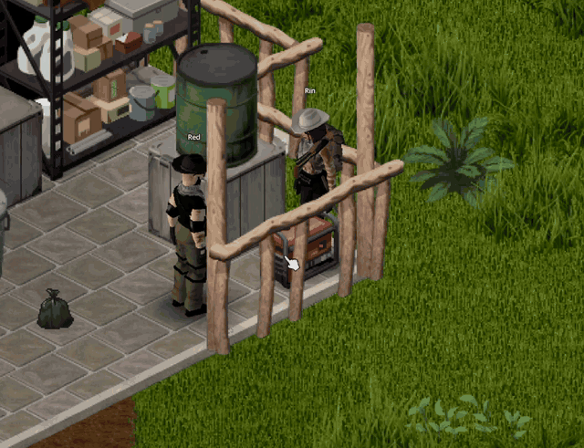
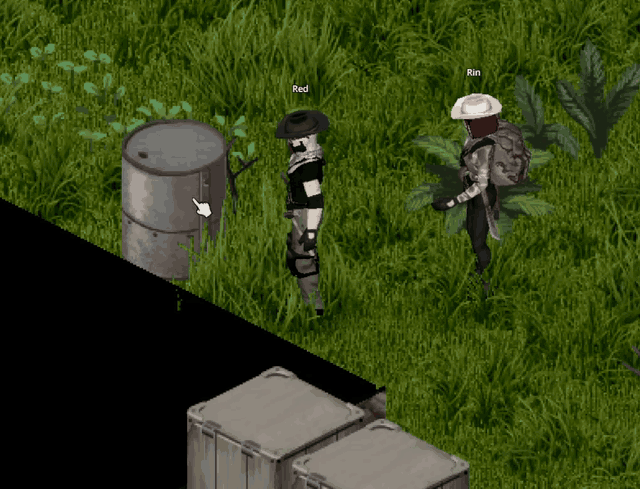
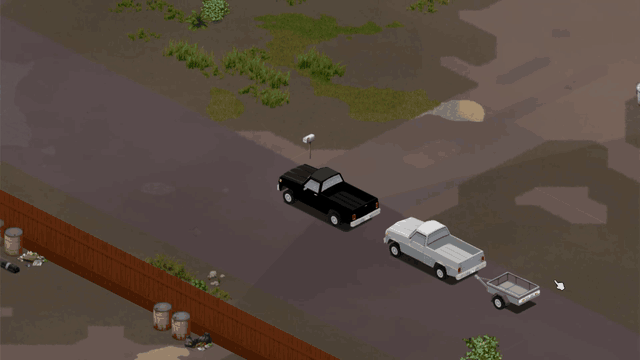
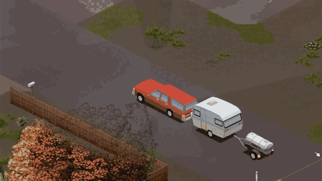
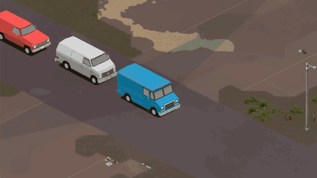

# Hose & Hitch [B42]

A Project Zomboid Build 42 mod. Vanilla-style common sense, everything through the game's own menus:

- **Fuel barrel for a generator.** Connect a barrel of gas to a generator with a rubber hose. Higher than the generator, gas flows by itself; on the ground you pour it by hand.
- **Roof barrels for the house.** Hoist a barrel onto the roof with a rope and a pipe wrench. Rain fills it, and the house taps below get water from it once the water is shut off.
- **Barrels on crates.** A barrel goes on a crate, a table or an orange barrel. Any barrel holds 400 L.
- **Double tow.** Behind a towed car, hitch a trailer or another car; behind a trailer, another trailer. Hitch in any order.
- **Bigger trunks.** Trunks, truck beds and trailer beds hold more.

Every language in the game.

Not compatible with Knox Water: both feed house taps from roof barrels.

## License

All rights reserved. See [LICENSE.txt](LICENSE.txt). Playing, using it on your own servers and changing it for personal use are fine; do not reupload or reuse code or assets without permission.
